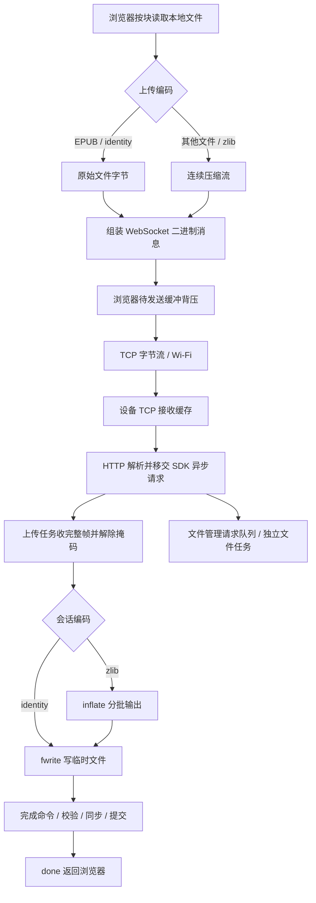

# 470 AP 文件传输实现

本文说明 `xingzhi-ai-470` 当前 AP 文件管理与上传实现，包含网络生命周期、数据处理、流控、内存、文件保护和 S31 配置。整理日期：2026-10-23。源码和 `sdkconfig` 是实际行为依据；构建验证与真机验证分别记录。

## 1. 使用方式与服务边界

在设备传输页打开 `Metalio-xxxx` 热点，电脑或手机连接后访问 `http://192.168.4.1/`。页面资源内置，无需外网。

- 网页、目录、容量、文件管理和下载使用 HTTP。
- 上传使用同端口的 `ws://192.168.4.1/ws/upload`，由 HTTP 握手升级为 WebSocket。
- WebSocket 同时承载开始、完成、取消、心跳命令，二进制文件正文，以及设备进度。
- 浏览器维护串行队列，每个文件使用独立连接；设备同一时间只接受一个上传任务。
- 当前传输热点为开放 AP，服务使用 HTTP/ws；它与 STA 配网门户是不同入口。

## 2. 源码位置与职责

- [ap_transfer.cc](../main/display/screen/cloud_screen/ap/ap_transfer.cc)：AP/HTTP 启停、路由、WebSocket 会话、数据解压、文件写入和提交。
- [ap_transfer.h](../main/display/screen/cloud_screen/ap/ap_transfer.h)：传输服务对外入口。
- [ap_request_worker.cc](../main/display/screen/cloud_screen/ap/ap_request_worker.cc)：内部有界异步请求队列、PSRAM 工作任务及停止屏障。
- [fileman.html](../main/display/screen/cloud_screen/ap/fileman.html)：文件管理界面、队列、压缩、发送背压、进度与取消。
- [cloud_chrome.cc](../main/display/screen/cloud_screen/cloud_chrome.cc)：页面无线模式切换与结果回传。
- [pack_ap_fileman.py](../scripts/pack_ap_fileman.py)：内嵌页面图片并生成 gzip 资源。
- [SdCardManager.cc](../main/boards/common/storage/SdCardManager.cc)：SD 挂载、总线配置及 DMA 对齐中转缓冲。
- [wifi_station.cc](../components/esp-wifi-connect/wifi_station.cc)：STA 启停及每次启动时应用功率限制。
- [wifi_station.h](../components/esp-wifi-connect/include/wifi_station.h)：470 的固定 TX 功率请求上限。
- [sdkconfig.defaults.esp32s31](../sdkconfig.defaults.esp32s31)：S31 默认配置；当前构建配置见 [sdkconfig](../sdkconfig)。

引脚和外设参数继续以板型配置为准，本文件不复制引脚表。

## 3. AP 与服务的生命周期

启动入口为 `ApTransferStart()`，主要顺序如下：

1. 串行保护无线切换，检查待机约束及是否已经启动。
2. 准备事件循环、AP 网络接口及 DHCP 地址。
3. Wi-Fi 未初始化时创建驱动；已经初始化时暂停原 STA，记录恢复所需状态。
4. 切换到纯 AP，启动热点，关闭 Wi-Fi 省电，设置本板型最大 TX 功率。
5. 创建独立上传任务和文件管理任务，再启动端口 80 的 HTTP 服务，注册普通路由和 `/ws/upload`；不增加端口或更改浏览器协议。

启动中途失败走已有关闭路径，避免遗留半初始化服务。无线切换复用单个后台任务，页面存续期间以通知阻塞等待，栈优先使用 8 KiB PSRAM；离页提交停止请求，关闭完成后退出并释放栈。UI 不等待 HTTP、Wi-Fi 或工作任务退出。

停止入口 `ApTransferStop()` 先禁止新请求并标记上传取消，关闭所有已登记客户端 socket 的读写方向，唤醒包括半个报头、上传正文和文件响应在内的阻塞读写。两个工作队列排空后再停止 HTTP；此时 SDK 关闭连接并投递会话回收，上传任务处理完这些回收项后退出，再退出文件管理任务，最后关闭 Wi-Fi。启动中途失败也走同一顺序，不直接在注册路由失败处停止仍有异步请求的 HTTP 服务。按调用参数及原 STA 状态恢复联网；切换 U 盘或待机等路径可以不恢复 STA。

上传期间允许浏览目录、读取容量和追加浏览器队列；无关文件仍可新建、删除、改名或移动。设备拒绝操作当前上传目标、删除或改动其父目录，以及将其他项目改名或移动到当前目标。目标路径借用活动会话缓冲，受上传状态锁保护，完成或失败时清除。上传期间禁止下载，网页点击文件也只提示，不跳转离开上传页。HTTP 服务只解析和分派请求，上传与文件管理分别在独立任务处理。上传开始、提交和清理与文件目录变更共用递归互斥，防止路径校验与执行之间发生竞态；上传中的分块写入不持有该管理锁，由同卷 FatFs 锁保护实际 SD 操作。目录快照构建完成后提前释放管理锁，再发送 JSON，慢客户端不会因此长期占用管理锁。物理 SD 卡和总线仍共享，目录扫描、递归删除或文件提交仍可能影响吞吐和元数据操作延迟。设备其他业务也必须避免操作上传目标文件；这里只保护传输服务自身的操作。

## 4. 数据链路总览



当前应用层在独立 `ap_upload` 任务中执行“接收一帧 → 解压/写入 → 完成异步请求”。`ap_files` 独立处理目录、容量和文件管理请求，HTTP 服务任务不再等待正文接收、解压、写卡或递归删除。每个连接至多一个 SDK 异步请求在途；SDK 完成通知后才恢复该连接的读取，以 TCP 接收窗口形成背压。每个任务队列固定 8 项，全服务最多 4 个客户端，上传会话也受 4 个名额限制；队列保存请求描述符，不另行复制多帧正文。这是有界单帧处理，未增加接收/写卡双缓冲流水线。底层 Wi-Fi 和 TCP 仍可缓存后续数据。

SDK 默认处理 WebSocket PING/CLOSE，PONG 继续投递上传任务，用于现有心跳确认。CLOSE 不异步移交，避免 SDK 在请求完成前回收会话；关闭回调只投递上传任务进行文件清理与内存释放。接收失败会关闭连接读写并完成异步请求，随后 SDK 回收会话。客户端描述符登记锁保证退出时的 shutdown 不会误操作已关闭并复用的描述符。

## 5. 上传协议与状态

### 5.1 开始与准备

浏览器先检查容量及队列预留空间，建立连接后发送文本 JSON。例如上传一个 12345 字节的 EPUB：

```json
{"op":"start","id":"upload-1","path":"/","name":"example.epub","size":12345,"replace":false,"encoding":"identity"}
```

设备检查名称、目录、大小、容量、同名保护和遗留临时文件，创建 `.part` 后返回：

```json
{"event":"ready","id":"upload-1","state":"receiving","total":12345,"received":0,"written":0,"wire":0,"active":true,"error":"","chunk":4096,"encoding":"identity"}
```

浏览器检查任务 ID、计数、状态、分块大小和编码一致后才发送正文。会话在握手后的首条数据到达时创建，适配当前 ESP-IDF 6.1 握手处理流程。

任务 ID 长度为 1～31 个字符，仅接受小写字母、数字和连字符。任务归属创建它的连接，其他连接不能发送正文、取消或完成该任务。设备保留最近一个任务结果，拒绝该 ID 的重复上传。

开始失败返回 `event:"error"` 和错误说明。编码不支持或协商不一致时停止，不静默切换编码。

### 5.2 正文、进度与完成

正文以二进制消息发送，最后一块可短于约定块大小。线上载荷跨过每个进度边界后，设备推送 `event:"progress"`；进度用于展示和校验，不驱动浏览器续发。

- `total`：声明的原文件字节数。
- `wire`：收到的二进制载荷字节数，不含 WebSocket/TCP/IP 帧头。
- `received`：交给写入函数的原文件字节数；压缩模式下是解压后的数量。
- `written`：`fwrite()` 实际返回的写入字节数，不代表最终同步已完成。

浏览器百分比及速率按 `received` 计算。压缩模式的原文件处理速度可能高于线上载荷速度；比较吞吐时应同时看原文件大小、`wire` 和总耗时。页面绘制最多约每 100 ms 更新一次。

正文和压缩尾部全部排入 WebSocket 后，浏览器发送：

```json
{"op":"finish","id":"upload-1"}
```

同一连接的有序传输保证完成命令排在此前正文之后。设备验证通过后立即返回最终接收进度并进入 `saving`；同步及提交成功后返回 `done`、`active:false`。浏览器只有确认 `done` 且写入量等于文件大小，才结束本项并开始下一项。

状态路径为 `receiving → saving → done`；错误和取消分别结束为 `failed`、`cancelled`。

文件提交成功后使阅读书库缓存失效，下次进入阅读或书架时重新扫盘；AP 删除（含部分删除）、改名、移动及备份恢复也同步失效缓存。失败或取消的上传不按成功提交处理。壁纸在进入应用时重新扫描 `metalio/e-ink/wallpaper` 本层；书籍需位于 `metalio/e-ink/books` 或其子目录，上传到其他位置不会自动加入应用列表。App 推送书籍下载完成后已有书库缓存失效处理，壁纸同样在进入应用时扫盘。

阅读设置每次打开或切换到字体页签时，先在字体容器内显示“字体加载中…”，再由单个低优先级任务扫描 `metalio/e-ink/fonts` 本层；完成后由 UI 发布列表。切走页签、关闭阅读或待机会作废扫描结果，快速返回时等待旧任务退出后再启动新一轮，后台不操作控件或共享字体列表。扫描失败显示容器内错误提示，空目录显示原有空态；列表重绘和多选操作不重复扫描。AP 上传或 App 推送的 `.ef` 字体在下次进入该页签时显示，不要求重开书籍，扩展名不区分大小写。TTF/OTF 保存在 `metalio/e-ink/fonts_ttf`，需通过“导入 TTF”转换后才出现在已安装字体列表。

## 6. 压缩机制

### 6.1 identity 与连续 zlib

EPUB 按原文件扩展名判断，不区分大小写，使用 `identity`：整个 EPUB 容器逐字节原样传输，不展开章节和图片，也不再次压缩其内部 ZIP 数据。

其他文件在浏览器可创建 `CompressionStream("deflate")` 时协商 `zlib-stream-v1`。这是一条完整文件的 zlib 包装 DEFLATE 流：

- 压缩字典跨读取块和 WebSocket 帧保留，不逐块重建。
- 压缩器输出与源文件读取块不一一对应；小段输出先聚合，尾部不足一帧也发送。
- 设备复用 `inflate` 状态，以固定输出缓冲循环解压和写入，不展开整个文件。
- 设备要求流结束、Adler-32 校验通过、无尾随数据，且原文件字节数精确匹配声明。
- 空文件在压缩模式下仍发送完整的空 zlib 流；identity 空文件只执行开始与完成。

浏览器不能创建压缩器时，从开始就使用 identity。连续压缩一旦开始，运行中失败即终止，不逐块回退。当前只有 EPUB 被按类型排除，ZIP/JPEG 等其他已压缩格式仍可能进入 zlib 路径，收益需实测。

### 6.2 与网页压缩及掩码的区别

页面源由构建脚本内嵌标识图片并生成 `ap_fileman.html.gz`，嵌入 Flash；设备直接发送 gzip，浏览器展开，设备不在 RAM 解压页面。打包时图片与页面分别结束 DEFLATE 块，减少内嵌 base64 对压缩率的影响。

网页 gzip、上传应用层 zlib、EPUB 内部 ZIP 是不同处理层。上传不启用 WebSocket `permessage-deflate`；客户端掩码由 SDK 解除，属于协议异或处理，不是压缩或加密。

## 7. 发送节奏与 TCP 流控

### 7.1 浏览器背压

浏览器每次发送前检查 `ws.bufferedAmount`。超过阈值时，等待后重复检查，同时响应取消和连接关闭；不是每发送一帧固定休眠。

这个值表示浏览器尚未传送出去的 WebSocket 数据，不涵盖已进入网络和设备的数据。阈值也不是绝对上限：检查通过后再发送一帧，会使待发送缓冲继续增加。当前已移除原 512 KiB 应用确认窗口，不等设备进度再发送下一帧。

### 7.2 TCP 拆分、确认与停顿

TCP 传递连续字节流，不保留应用消息边界。一个 WebSocket 帧可跨多个 TCP 段，一个 TCP 段也可包含不同帧的内容；SDK 按 WebSocket 帧头长度重新组装消息。

接收端按字节序号排序，ACK 确认连续收到的数据；启用并成功协商 SACK 时，可以附加报告乱序到达的区间。缺口未补齐时，后续数据不能越过缺口交给上层，这会使同一连接上的正文、进度和心跳受到队头阻塞影响。

发送还受接收窗口及发送端拥塞控制约束。设备应用读取不及时会使 TCP 接收额度减少，额度归零时对端暂停正常的新数据发送，等待窗口恢复。应用读走 socket 数据后可能释放接收额度，无须等 SD 同步完成；但串行写卡会延后下一次读取，仍可能间接造成背压。

TCP ACK、设备 progress、设备 done 分别对应协议栈接收、应用处理、文件提交完成，不能相互替代。单看发送间隔不足以区分浏览器节流、窗口限制、重传或设备处理耗时。

上传连接在会话创建时启用设备端 `TCP_NODELAY`，设置失败关闭连接。它用于减少设备小消息的 Nagle 等待，不修改浏览器 TCP 策略，也不能消除丢包、拥塞或写卡停顿。

## 8. 缓冲与 SD 写入

上传相关大小在各自源码处维护，当前为：

- 源文件读取及 WebSocket 载荷：每块最多 4 KiB。
- 浏览器待发送缓冲检查阈值：8 KiB；等待后每 5 ms 检查。
- 设备接收缓冲：4 KiB，加 1 字节文本结束符。
- 压缩模式解压输出：每批最多 16 KiB；zlib 滑动字典最多 32 KiB，另有状态内存。
- 设备进度：每跨过 64 KiB 线上载荷边界反馈一次；完成、失败及取消立即反馈。

上传会话对象及接收缓冲按连接创建并复用，启用 PSRAM 时仅从 PSRAM 分配，不回退挤占内部 RAM。解压输出、zlib 状态和字典按需分配于 PSRAM，identity 不创建解压资源。连接关闭后由上传任务释放全部会话资源并归还会话名额。

HTTP、上传和文件管理任务各用 16 KiB 栈，本项目启用外部任务栈后均放 PSRAM；两个工作任务只在热点期间存在。队列内容缓冲也放 PSRAM，控制块和少量锁/描述符登记使用静态内部 RAM。SDK 异步请求的元数据分配沿用 SDK 和系统堆策略，任务 TCB 仍有内部 RAM 成本；固定连接数与队列长度限制其上界。新增任务栈共 32 KiB PSRAM，并非每个文件新建任务。上述缓冲不是总内存预算，还需计算 Wi-Fi、lwIP、stdio/FatFs、任务及其他业务占用；内部 RAM 和 DMA 历史最低值仍需硬件验收。

写入路径为 `fwrite → stdio → FatFs → SDMMC → SD 卡`。S31 挂载时准备共享的 4 KiB 对齐内部 DMA 中转缓冲，供 SDK `dma_aligned_buffer` 使用；主机缓冲检查拒绝 PSRAM 直接 DMA，使外部数据由 SDK 复制后按最多 8 扇区中转。已对齐的内部数据仍可直接传输。相较此前 PSRAM 中转方案增加约 4 KiB 内部 DMA 常驻占用，释放卡时回收；上传缓冲、解压缓冲和任务栈仍优先放 PSRAM。其他芯片保留 512 字节内部 DMA 缓冲。此为隔离 S31 外部 DMA/cache 同步影响的保守配置，尚未真机确认超时根因。

同卷 FatFs 锁保护 SD 访问及共享中转缓冲；USB 导出必须维持本机与主机互斥。USB 工作任务按请求创建并退出，不在关闭路径初始化 USB，也不因进入面板而预建工作任务。

## 9. 文件保护与最终提交

上传正文先写入目标目录的 `.cz-<文件名>.part`，原文件在接收期间保持不动。容量按新文件完整大小预留，不提前释放旧文件空间。

收到完成命令后先校验长度及压缩流状态，再依次执行：

1. 推送 `saving`，界面显示设备保存中。
2. `fflush()` 刷新 stdio 缓冲。
3. `fsync()` 请求文件系统同步。
4. `fclose()` 关闭文件并检查结果。
5. 重新检查目标状态；显式允许覆盖时，将旧文件改名为 `.cz-<文件名>.bak`。
6. 将 `.part` 改名为正式文件；失败时尝试还原旧文件，成功后清理备份。
7. 推送最终结果。

同步、关闭及提交与退出请求配合保护，写入错误按已知 errno 区分空间不足、内存不足和 SD I/O 错误。通用 I/O 错误不推断为 DMA 或容量问题。

浏览目录或开始上传时，恢复逻辑会清理未提交临时文件、恢复遗留备份；活动上传目标及其相关临时文件会被跳过，其余遗留备份仍正常恢复，避免管理操作覆盖未恢复的原文件。该方案保护正常断线和可恢复的文件操作失败，不构成文件系统级断电原子事务；介质损坏、断电及恢复边界仍需真机验证。identity 没有额外的应用层整文件哈希校验，验收时需在主机比较原文件和回读文件哈希。

## 10. 取消、断线和超时

用户取消时，浏览器停止读取和发送新块，再通过所属连接发送：

```json
{"op":"cancel","id":"upload-1"}
```

已经排入 TCP 的字节无法撤回，取消命令需要排在它们之后处理，因此取消不是立即丢弃全部在途数据。设备关闭并删除未提交文件后回报 `cancelled`。进入保存阶段后网页不再提供取消按钮。

断线、无效帧或写入失败会触发会话清理。退出 AP 使用 socket 中断唤醒阻塞接收并等待收尾。若提交已完成但最终响应丢失，浏览器无法仅凭断线判定成功或失败，会提示重新连接、刷新目录确认，不自动重传；手动重试使用新任务 ID。

- socket 单次接收、发送等待超时：均为 60 秒，不是整文件期限。
- 网页无有效进度响应超时：120 秒。
- ready 后每 60 秒发送带任务 ID 的 `op:"ping"`，设备触发原生 WebSocket Ping；浏览器自动 Pong，设备再发送 `event:"pong"` 通知页面。
- 下一心跳周期仍未收到 Pong 通知则终止；保存或取消中不再发起心跳。
- Pong 不重置进度超时；完成、失败、取消均清理定时器。
- TCP keepalive 配置为空闲 10 秒、间隔 5 秒、3 次探测，辅助发现失联。

## 11. 文件管理接口与限制

- `/api/storage` 返回挂载状态和总量、剩余容量；网页检查队列预留，设备开始每项时再次检查。
- `/api/files` 返回目录，最多展示 200 项，截断时明确提示。目录不完整时网页停止添加该批上传，设备继续兜底同名保护；列表暂存放 PSRAM。
- `/download` 使用 HTTP，逐次从 SD 读取 1 KiB 并发送响应，不使用上传的压缩编码。
- `/mkdir`、`/delete`、`/rename`、`/move` 管理目录和文件。递归删除使用迭代遍历，不累积目录句柄与递归栈，失败即停止并报告已删除数量。
- 名称最多 246 个 UTF-8 字节（中文通常约 82 字，含扩展名），网页路径最多 511 字节；名称为 `.cz-` 和 `.part` 预留 9 字节，确保临时文件也不超过 FAT 长文件名上限；HTTP URI 缓冲同步扩大到 1600 字节；拒绝越界路径和根目录删除。
- `.cz-` 为传输服务保留前缀，网页不能直接操作这些文件。
- 文本命令最多 1280 字节，拒绝 WebSocket 分片消息、超长二进制帧、超出声明长度的输出、压缩校验错误、截断和尾随数据。
- 原 HTTP multipart 上传、进度查询和取消接口已移除；刷入新固件后重新加载网页。

上传过程中可继续选择文件、查询目标目录并追加队列；记录按新任务在顶部展示，实际发送仍为先加入先发送。同名文件可选择保留两份、替换或跳过，并可应用于该批冲突。关闭上传面板只收起界面，不清空队列；清除记录只移除完成、失败和取消记录，不删除 SD 文件。“取消本次添加”只取消对应添加批次。

删除确认支持逐项移除和长名称展开，全部移除后不发送删除请求；删除失败或断线后刷新确认，已删除内容无法撤销。

## 12. S31 无线配置与对照适配

当前按 RickyOS-Plus-1.2 / 1.2.5 启动日志对齐兼容参数：

- TCP 接收窗口 32768 字节、发送缓冲 5760 字节、MSS 1440。
- TCP 接收邮箱 32 项、TCP/IP 接收邮箱 32 项；accept/UDP 邮箱均为 6 项。
- 动态 RX 上限 32、静态 RX 6、RX BA 窗口 12、静态管理接收缓冲 5。
- TX/RX A-MPDU 开启；TX BA 窗口配置为对照日志的协商值 64，实际连接结果仍须观察。
- Wi-Fi/lwIP 优先 PSRAM 开启，使用静态 TX 6、缓存 TX 4。
- 对照日志没有确认的乱序 pbuf 上限 12 和 SACK 沿用现值。

当前内存对照试验将静态 TX/RX 都降为 6，以减少内部 DMA 常驻压力；收益和语音启动结果待真机验证。与对照日志的差异如下：

1. 日志为静态 RX 4、RX BA 16；本机编译检查要求 BA 不大于静态 RX 的两倍，因此本轮静态 RX 6 对应 BA 12。
2. 日志为动态 TX 32；本机 Kconfig 在开启 PSRAM 优先后不允许动态 TX，因此本轮使用静态 TX 6，缓存数量保持为 4。

这些差异也可能涉及对方运行时初始化覆盖，不能把其启动日志等同于一份完整 sdkconfig。当前配置作用于固件 AP 和 STA；STA 显式使用 b/g/n 并关闭省电，不能由此断言 AP 的所有协议设置与对方 STA 相同。

470 的 STA 和 AP 文件传输共用固定 TX 功率请求上限 `48`，单位 0.25 dBm，即请求 12 dBm。常量只在 `wifi_station.h` 维护；本板型不使用此前保存的 NVS 功率偏好，不再提供网络页自定义功率、保存或重启入口。STA 每次启动（含待机恢复）和 AP 启动后应用，设置失败按原错误路径处理。

SDK 可能量化功率档位：本机 `esp_wifi.h` 的表将原始请求 `[44,51]` 映射为 `44`，对应 11 dBm。因此“请求 12 dBm”不等于最终逐包射频输出为 12 dBm。按清理要求，设置后的回读诊断和打印已移除；当前尚无本次硬件实测。

SDK 的 PHY 最大功率配置最低为 10 dBm，当前通过运行时 API 设置上述限制。AP 固定频道及连接数等设置见 `StartRadio()`，不根据对照日志中的 STA 信道推改 AP 信道。

对照固件标识的 IDF 提交为 [9a97f6c54ec638111ce55cd36581b3c192f15207](https://github.com/espressif/esp-idf/commit/9a97f6c54ec638111ce55cd36581b3c192f15207)，2026-09-22 合入 `release/v6.1`，该提交本身仅修改 panic 测试的 espcoredump 串口参数。本项目本轮未切换 SDK，不能宣称驱动版本已完全对齐。

## 13. 诊断与吞吐判读

临时 `UPDIAG` 计时、逐帧统计和汇总日志已清理，保留上传错误及浏览器协议必需的线上字节进度计数。`CONFIG_LWIP_SO_RCVBUF` 保持原配置。

对照测速使用同一文件、电脑、距离和无线拓扑；同时看总耗时、线上字节、TCP 窗口变化、重传、发送停顿与设备处理耗时。对方 STA 接电脑热点的结果不能直接等同于本项目设备 AP 的性能。普通电脑抓包不包含完整无线重试信息，重复捕获记录也必须先识别去重。

## 14. 验证状态与构建注意事项

截至本轮，上传发送模拟覆盖了 EPUB 大小写扩展名、空文件、尾块、连续压缩、无压缩器回退、不依赖中途进度继续发送、背压期间取消与断线；模拟传输数据还原一致。配置经过生成结果核对；最新 TX 功率改动后整包构建和分区容量检查通过。临时主机测试产物已清理。

2026-10-23 清理自定义 TX 功率和网络诊断后，整包镜像为 `0x4fe470` 字节，5 MiB OTA 分区剩余 7056 字节，未修改分区布局。日志上传已移除修改 TCP MSS 的回调和 512 字节写入上限，部分写入、失败、取消和截止时间通过提取实际 C++ 函数的主机桩测试；临时测试文件已清理。源码及镜像检查确认不再包含本轮移除的网络、上传和 TX 回读诊断格式串；已清理应用和传输层中的接口地址、请求头、正文、会话标识及 AT 原文输出，不据此保证 SDK、驱动和第三方库的独立日志全部脱敏。

同日修复上传交互后，主机验证覆盖上传中目录查询及追加队列、重名检测、新记录置顶且 FIFO 发送、无关文件删除/改名/移动、活动目标及父目录保护、临时文件与备份恢复，以及上传时禁止下载和网页跳转。页面脚本语法、整包构建和分区检查通过，镜像为 `0x4fe600` 字节，OTA 分区剩余 6656 字节；临时测试产物已清理，尚未进行本轮真机交互测试。

上传与文件管理拆分后，主机桩测试使用实际任务调度模块，覆盖独立任务并发、有界请求拒绝、取消/排空/回收、异步请求恰好完成一次、任务重启，以及队列/任务/请求复制分配失败。提取实际上传和文件处理函数验证了提交、取消、断线、热点退出、会话/解压资源释放及路径互斥；慢目录响应不会持有文件管理锁。连接登记测试覆盖退出中新连接、容量溢出和单次关闭所有权。SDK 异步请求及 WebSocket 控制帧的生命周期已核对本机源码，尚未完成真机并发回归。

最新整包镜像为 `0x46e4d0` 字节，OTA 分区剩余 596784 字节（约 583 KiB）；整包、分区和页面脚本语法检查通过。任务静态控制对象、锁和描述符登记约新增 0.8 KiB 内部静态 RAM，另有 FreeRTOS TCB 和 SDK 元数据成本；新增任务栈为 32 KiB PSRAM。主机自检不能证明设备内部 RAM/DMA 最低水位达标，临时测试源码、桩头文件和程序已清理。

尚未完成本轮真机吞吐、实际射频功率、最低内部/DMA 空闲及断电恢复验收，不能把主机模拟、源码编译或整包构建写成硬件测试通过。内部空闲 RAM 应遵守项目预算，并观察最大连续块及分配失败。

真机重点检查：

- 上传后回读哈希、空文件、大文件、中文及长文件名。
- 压缩流跨帧头尾、校验错误、截断及高压缩率文件。
- 中途取消、断线、退出 AP、空间不足、拔卡和覆盖恢复。
- AP/STA 切换、待机恢复、DHCP、OTA 。
- TCP 窗口、暂停分布、CPU/存储耗时及内部/DMA 内存。

曾出现镜像 5243120 字节超过应用分区 5242880 字节，bootloader 因镜像超限拒绝启动；备用槽为空时会循环复位。应使用容量检查通过的新固件恢复，不能仅因生成了 `.bin` 就认定构建成功。当前应用分区余量很小，后续每次修改均需以构建的 `app_check_size` 结果为准。


上传写入、刷新或同步返回 EIO 时锁存内存卡故障，停止接受新上传；当前上传收尾后，设备传输界面显示“内存卡状态异常，请重启设备后再试”及“重启”按钮，重复错误不叠加窗口。点击后由应用线程关闭 AP 传输再重启；空间不足和内存不足不触发此窗口。此处按实际存储返回值识别，不解析 SDK 日志，也不覆盖其他业务的独立 SD 故障。

上传暂停日志落盘的试验未消除超时，已删除该暂停 API、状态及所有调用，恢复日志原有行为。检查显示上传为单任务顺序写入，FatFs 卷锁覆盖共享中转缓冲的复制和磁盘事务，尚未发现双任务同时改写该缓冲的路径。当前用内部 DMA 中转单独隔离 PSRAM 直接 DMA，保持 SD 时钟、上传分块和文件管理并发策略不变，需重复上传对比验证。

页面退出/重建只通过 `CloudRadioAbandon()` 标记停止和使旧代结果失效。停止意图与最新模式分别保留，快速退出重进也会先完成旧 HTTP、上传/文件任务及射频清理，再启动最新模式；所有等待均在同一射频任务执行。待机请求立即禁止新 AP 启动，后台关闭且不恢复 STA；唤醒沿用同一调度顺序。任务创建失败不在 UI 同步回退启动/关闭。STA 暂停接口在 AP 模式下拒绝停止整个 Wi-Fi；已开始的联网等待发现纯 AP 后提前退出，避免旧超时干扰热点。软件启动成功不代表已验证空口广播，热点可见性仍需真机扫描确认。

## 2026-10-23 SDK 写入错误与持续写入对比

本机 SDK 位于 `F:/idf/v6.1/esp-idf`，基础提交为 `fff9895c8`。已修复 `sdmmc_write_sectors_dma()` 的错误码覆盖：CMD25 失败后查询已写块数使用独立返回值，向 FatFs 返回原始写入错误。该覆盖由本地历史提交 `cfcfb3f9e` 引入，不能把修复错误传播等同于修复最初的 CRC。

SDK 每次启动仅记录第一笔写命令执行失败：原始命令、扇区、块数、长度、原始返回码/命令错误/响应、缓冲及栈是否在外部 RAM、任务名与核心；在 CMD13 和恢复查询前记录。底层另保留一次原始 SD/DMA 事件，以区分数据 CRC、响应 CRC、超时和 DMA 错误。正常写入无新增逐块输出，未引入重试、忽略 CRC 或失败当成功的路径。

补丁保存在 `patches/esp-idf/sdmmc-preserve-write-error.patch`。本机已应用；其他环境先在对应 IDF 根目录执行 `git apply --check <补丁绝对路径>`，检查成功后再执行 `git apply <补丁绝对路径>`，不重复应用。应用后的回归检查覆盖恢复查询成功/失败、原始错误保持、日志首次限频、单块及多块正常返回。

真机使用 COM1322、ESP32-S31 v0.0、当前同一张约 3.84 GB 卡；通过独占创建的临时文件测试，不进行裸扇区写入。数据按位置生成并在成功写完后全量回读比较；失败组没有完成全量回读，不能列为校验通过。每轮重新启动，具体后台时序与文件物理位置并不完全一致，结果仅代表本设备/本卡本轮实验。

- 启动阶段，单块，内部栈/缓冲，后台日志未启动：写入 16.000 MiB，56.171 秒，全量回读 16 MiB 一致，约 291.7 KiB/s。
- 启动阶段，8 扇区，内部栈/缓冲，后台日志未启动：写入 16.000 MiB，9.744 秒，全量回读 16 MiB 一致，约 1681.4 KiB/s。
- 正常后台，8 扇区，PSRAM 栈/缓冲：写入 14.465 MiB，14.333 秒，失败 errno=5，未完成全量校验。
- 正常后台，8 扇区，内部栈、PSRAM 缓冲：写入 16.000 MiB，10.215 秒，全量回读 16 MiB 一致，约 1604.0 KiB/s。
- 正常后台，8 扇区，PSRAM 栈/缓冲复测：写入 9.902 MiB，11.224 秒，失败 errno=5，未完成全量校验。
- 正常后台，8 扇区，内部栈、PSRAM 缓冲复测：写入 14.465 MiB，9.142 秒，失败 errno=5，未完成全量校验。
- 正常后台，单块，PSRAM 栈/缓冲：写入 16.000 MiB，57.804 秒，全量回读 16 MiB 一致，约 283.4 KiB/s。
- 停止 Wi-Fi，日志开启，8 扇区，PSRAM 栈/缓冲：写入 0.473 MiB，5.312 秒，失败 errno=5，未完成全量校验。
- 10 MHz，正常后台，8 扇区，PSRAM 栈/缓冲：写入 0.930 MiB，5.633 秒，失败 errno=5，未完成全量校验。
- 20 MHz，正常后台，2 扇区，PSRAM 栈/缓冲：写入 5.734 MiB，10.639 秒，失败 errno=5，未完成全量校验。

失败的首笔事件均指向 `CMD25 / 0x109 / sd_status=0x88`，即 DATA_OVER 与数据 CRC 错误，所采样 DMA 事件为零；后续 `0x107` 是另一阶段的超时，不能覆盖首次错误。已见 `buffer_internal=1` 和 `stack_external=0` 时同样失败，停止 Wi-Fi、降到 10 MHz、缩成 2 扇区也没有消除本轮故障。因此不能仅归因于 PSRAM 直接 DMA、外部任务栈、Wi-Fi 射频或 4 KiB 传输长度；DMA 事件为零也不等于排除所有 DMA/时序问题。单块完整通过仅说明该模式在有限样本中未复现，不能承诺所有卡永不失败。

当前仍保持 20 MHz、4 位、内部 4 KiB DMA 中转、8 扇区上限、PSRAM 优先的原有任务/数据分配及正常日志落盘，不保留低速或改栈试验。CMD25 多块写入的精确根因仍未确定；下一步需同卡独立 SDK 压测/换已知可靠卡对比，再针对驱动自动停止与卡忙时序检查，不能以关闭 CRC 检查规避。临时测试源码、入口、任务、脚本及专用生成物在验证结束后清理；失败遗留的测试文件已在后续重启后删除，成功组均当轮删除。

内部 16 KiB 栈试验中，内部空闲 RAM 的一次采样为 50483 字节，低于项目 50 KiB 目标，因此该试验不作为生产内存预算通过证明；且内部栈复测仍 CRC 失败，未保留该改动。正常固件构建及分区检查通过，镜像 `0x485890` 字节；启动观察不等于上传可靠性验收。

换卡对比：用户断电更换另一张卡，设备识别容量为 15200 MB（旧卡 3840 MB），仍使用 20 MHz、4 位、8 扇区、内部 DMA 中转与 PSRAM 栈/数据，后台 Wi-Fi/日志开启。首轮写入 32 MiB 用时 10.891083 秒，约 2.938 MiB/s，全量读回 32 MiB 一致，临时文件删除成功；未采集到首次写失败。单轮成功仅提示卡相关差异，不能据此排除驱动或板级兼容性。

新卡第二轮同条件写入 32 MiB 用时 10.880466 秒，约 2.941 MiB/s，读回全部一致，删除成功。两轮合计 64 MiB，均未出现首次写失败；本结果支持进一步检查旧卡与当前 S31/驱动的多块写入兼容性，尚不足以判定旧卡物理损坏或宣布 AP 上传已验收。两轮使用本地文件压测，不经过 WebSocket。
